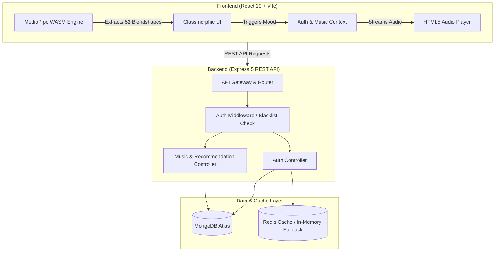

# 🎧 Emotify — AI-Powered Facial Emotion Music Experience

<div align="center">


**Scan your emotions in real-time and tune your audio experience to your mood.**

[Features](#-key-features) • [Architecture](#-architecture) • [API Reference](#-api-reference) • [Getting Started](#-getting-started) • [Tech Stack](#-tech-stack)

</div>

---

## 🌟 Overview

**Emotify** is a modern full-stack web application that uses computer vision to detect your facial expressions directly inside the browser and instantly generates matching music playlists and audio soundscapes.

Whether you're smiling, focused, surprised, contemplative, or energized, Emotify's edge-computed facial blendshape recognition pairs your vibe with tailored soundtracks, providing a fluid Spotify-grade listening experience.

---

## ✨ Key Features

### 👁️ Real-Time Client-Side Emotion Detection
- **Edge Inference via WebAssembly**: Powered by Google's MediaPipe Face Landmarker running completely in-browser. No webcam images or video streams are ever uploaded to a server—ensuring complete privacy.
- **52 Blendshape Categories**: Analyzes micro-expressions (smile symmetry, brow furrowing, jaw dropping, eye engagement).
- **Dual Operating Modes**:
  - **Snap Analysis**: Single snapshot scan with confidence score breakdown.
  - **Live Stream Tracking**: Continuous real-time emotion tracker that follows changes in facial expression.

### 🎭 7 Mood Soundscape Profiles
- **😊 Happy**: Upbeat indie pop and acoustic sunshine rhythms.
- **🌿 Calm**: Soothing ambient, meditation bells, and serene nature soundscapes.
- **⚡ Energetic**: High-octane electronic dance and synthwave beats.
- **🌧️ Sad / Healing**: Comforting piano ballads and warm lofi vibes.
- **😲 Surprised**: Wonder-filled cinematic swells and ambient discovery.
- **🔥 Intense**: Heavy rock rhythms and cathartic basslines.
- **🎧 Neutral**: Smooth focus beats and non-intrusive study tracks.

### 🎵 Spotify-Grade Integrated Music Player
- **Full Player Controls**: Play, pause, skip, previous, seek scrubber, shuffle, and repeat.
- **Animated Equalizer**: Dynamic frequency bars responding to playback state.
- **Volume & Mute**: Fine-tuned audio slider with one-click mute.
- **Quick Mood Switcher**: Interactive emotion pills to explore other vibes anytime.

### 📊 Personal Mood Analytics & Favorites
- **Mood Tracker**: Historical log of face scans with timestamps and emotion breakdowns.
- **Favorites Library**: Save beloved tracks with instant optimistic UI and database synchronization.
- **Visual Analytics**: Interactive distribution bars revealing your most frequent emotional states.

### 🛡️ Resilient 4-Layer Backend Architecture
- **JWT Authentication**: Unified authentication using secure HttpOnly cookies and Bearer tokens.
- **Token Blacklisting**: Instant logout invalidation using high-speed Redis caching with automatic memory fallback.
- **MongoDB Atlas Integration**: User profiles, favorite tracks, and emotion session history.
- **CORS & Proxy Ready**: Seamless local development and production readiness.

---

## 📐 Architecture



---

## 🔌 API Reference

### 🔐 Authentication (`/api/auth`)

| Method | Endpoint | Description | Auth Required |
|---|---|---|---|
| `POST` | `/api/auth/register` | Register a new user account | No |
| `POST` | `/api/auth/login` | Authenticate user and issue JWT token | No |
| `GET` | `/api/auth/get-me` | Retrieve authenticated user profile | Yes |
| `GET` | `/api/auth/logout` | Invalidate token and clear auth cookies | Yes |

### 🎶 Music & Moods (`/api/music`)

| Method | Endpoint | Description | Auth Required |
|---|---|---|---|
| `GET` | `/api/music/categories` | Get all available mood genres and track counts | No |
| `GET` | `/api/music/mood/:mood` | Get recommended tracks for a specific emotion | No |
| `GET` | `/api/music/favorites` | Fetch user's saved favorite songs | Yes |
| `POST` | `/api/music/favorites` | Toggle track in favorites | Yes |
| `GET` | `/api/music/history` | Retrieve user's mood scan history & statistics | Yes |
| `POST` | `/api/music/history` | Log a new emotion detection session | Yes |

---

## 🚀 Getting Started

### Prerequisites
- [Node.js](https://nodejs.org/) (v18.0.0 or higher)
- [npm](https://www.npmjs.com/) (v9.0.0 or higher)
- MongoDB Database (Local or MongoDB Atlas)

---

### 1. Clone the Repository
```bash
git clone https://github.com/harshit-tiwari-codebase/emotify.git
cd Emotify
```

---

### 2. Backend Setup

```bash
cd Backend
npm install
```

Create a `.env` file in the `Backend/` directory:
```env
PORT=3000
MONGO_URI=mongodb+srv://<username>:<password>@cluster0.mongodb.net/emotifyDB?retryWrites=true&w=majority
JWT_SECRET=your_super_secret_jwt_key_here
REDIS_HOST=localhost
REDIS_PORT=6379
REDIS_PASSWORD=
```
> *Note: If Redis is not available locally, Emotify's built-in fallback cache will automatically ensure zero disruption.*

Start the backend server:
```bash
npm run dev
# Server runs on http://localhost:3000
```

---

### 3. Frontend Setup

In a new terminal window:
```bash
cd Frontend
npm install
npm run dev
# App runs on http://localhost:5173
```

Open `http://localhost:5173` in your browser, allow camera permissions, and start detecting your emotions!

---

## 🛠️ Tech Stack

### Frontend
- **React 19** — Core UI library with modern hooks
- **Vite 8** — Fast bundler & development server
- **Tailwind CSS v4** — High-performance utility styles
- **@mediapipe/tasks-vision** — Google MediaPipe Face Landmarker
- **GSAP** — Fluid UI transitions & micro-interactions
- **Lucide React** — Modern, consistent icon library

### Backend
- **Node.js & Express 5** — RESTful backend framework
- **MongoDB & Mongoose 9** — Document persistence
- **ioredis** — Fast memory caching & token revocation
- **jsonwebtoken (JWT)** — Stateless user session management
- **bcryptjs** — Password hashing

---

## 🔒 Privacy & Security

- **Client-Side Face Processing**: Facial landmark detection is executed 100% on your device using WebAssembly. No video frames or biometric pictures ever leave your machine.
- **Secure Token Invalidation**: Blacklisted tokens are instantly cached with expiration policies to guarantee real-time session termination upon logout.
- **HttpOnly Cookies**: Prevents cross-site scripting (XSS) token theft.

---

## 📄 License

This project is licensed under the [MIT License](LICENSE).
